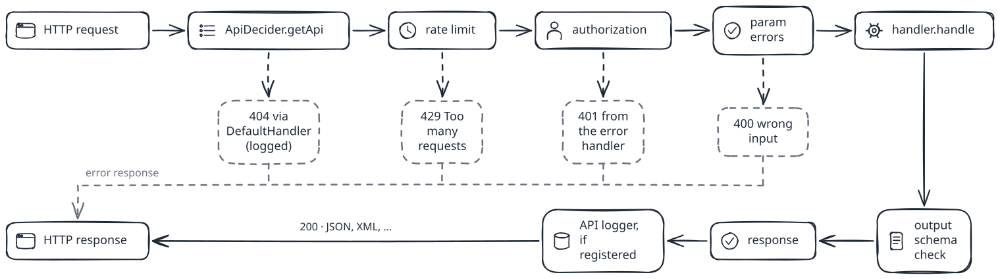

<h1>
  <picture>
    <source media="(prefers-color-scheme: dark)" srcset="docs/public/logo-dark.svg">
    
  </picture>
  Nette API
</h1>

> **Documentation: [tomaj.github.io/nette-api](https://tomaj.github.io/nette-api/)** (English, [slovensky](https://tomaj.github.io/nette-api/sk/))

[](https://github.com/tomaj/nette-api/actions/workflows/phpunit.yml)
[](https://github.com/tomaj/nette-api/actions/workflows/examples.yml)
[](https://packagist.org/packages/tomaj/nette-api)

Robust REST APIs inside your Nette application. Nette API adds a complete API layer to Nette, wired through Nette DI with one handler class per endpoint. You register endpoints and write handlers with your business logic; the library takes care of routing, typed and validated params, authorization, rate limits, output checks, error responses, logging, OpenAPI and a web console for trying the API.

<picture>
  <source media="(prefers-color-scheme: dark)" srcset="docs/public/diagrams/architecture-1-dark.svg">
  
</picture>

## Installation

Nette API 3.x needs PHP 8.3 or newer.

```bash
composer require tomaj/nette-api
```

## Quick start

Route `/api` to the library presenter:

```php
$router->addRoute('/api/v<version>/<package>[/<apiAction>][/<params>]', 'Api:Api:default');
```

Register the services and your endpoints in NEON:

```neon
application:
    mapping:
        Api: Tomaj\NetteApi\Presenters\*Presenter

services:
    - Tomaj\NetteApi\Presenters\ApiPresenter
    apiOutputConfigurator: Tomaj\NetteApi\Output\Configurator\DebuggerConfigurator
    apiErrorHandler: Tomaj\NetteApi\Error\DefaultErrorHandler
    - App\Api\HelloHandler
    apiDecider:
        factory: Tomaj\NetteApi\ApiDecider
        setup:
            - addApi(Tomaj\NetteApi\EndpointIdentifier('GET', 1, 'hello'), App\Api\HelloHandler, Tomaj\NetteApi\Authorization\NoAuthorization())
```

Write the handler:

```php
final class HelloHandler extends BaseHandler
{
    public function params(): array
    {
        return [
            (new GetInputParam('name'))->setDefault('world'),
        ];
    }

    public function handle(array $params): ResponseInterface
    {
        return new JsonApiResponse(200, ['message' => 'Hello ' . $params['name'] . '!']);
    }
}
```

```bash
curl http://localhost:8000/api/v1/hello?name=Nette
# {"message":"Hello Nette!"}
```

The [getting started guide](https://tomaj.github.io/nette-api/guide/getting-started) explains every line.

## What is in the documentation

| Topic | Page |
| --- | --- |
| How a request is processed | [Architecture](https://tomaj.github.io/nette-api/guide/architecture) |
| What each layer does: ApiDecider, presenter, authorization, params, handler, outputs | [Layers](https://tomaj.github.io/nette-api/guide/layers), [ApiDecider](https://tomaj.github.io/nette-api/guide/api-decider), [ApiPresenter pipeline](https://tomaj.github.io/nette-api/guide/presenter) |
| Handlers, params and outputs | [Handlers](https://tomaj.github.io/nette-api/guide/handlers), [Params](https://tomaj.github.io/nette-api/guide/params), [Outputs](https://tomaj.github.io/nette-api/guide/outputs) |
| Bearer tokens, API keys, HTTP Basic, IP restrictions | [Authorization](https://tomaj.github.io/nette-api/guide/authorization) |
| Rate limits, CORS, logging, errors | [Rate limiting](https://tomaj.github.io/nette-api/guide/rate-limit), [CORS](https://tomaj.github.io/nette-api/guide/cors), [Logging](https://tomaj.github.io/nette-api/guide/logging), [Error handling](https://tomaj.github.io/nette-api/guide/errors) |
| OpenAPI, web console, `{apiLink}` | [OpenAPI](https://tomaj.github.io/nette-api/guide/openapi), [Web console](https://tomaj.github.io/nette-api/guide/console), [Links and versions](https://tomaj.github.io/nette-api/guide/links) |
| Every class | [Reference](https://tomaj.github.io/nette-api/api/reference) |

## Security notes

* **CORS:** `setCorsHeader('auto')` reflects any site from the `Referer` header and allows credentials. Use `setCorsAllowedOrigins([...])` (since 3.6.0) or one fixed origin. See [CORS](https://tomaj.github.io/nette-api/guide/cors).
* **Logs:** request headers reach `ApiLoggerInterface` as they arrived. Call `setMaskedLogHeaders()` on `ApiPresenter` (since 3.6.0) to log `***` instead of `Authorization`, `Cookie`, `X-Api-Key` and other secrets. See [Logging](https://tomaj.github.io/nette-api/guide/logging#masking-headers).
* **Tokens and passwords:** `BasicAuthentication` and `StaticTokenRepository` compare with `hash_equals()` (since 3.6.0). See [Authorization](https://tomaj.github.io/nette-api/guide/authorization).

## Examples

Thirteen runnable projects in [`examples/`](examples/), each with an `e2e.sh` test that CI runs against the current code:
[hello world](examples/hello-world), [params and validation](examples/params-validation), [authorization and rate limit](examples/auth), [CORS](examples/cors), [OpenAPI and console](examples/openapi-console), [logging and errors](examples/logging-errors), [custom authorization](examples/custom-authorization), [JSON and raw body](examples/json-body), [file upload](examples/file-upload), [pagination](examples/pagination), [API versions](examples/versions), [rate limit](examples/rate-limit), [testing](examples/testing).

## Upgrading

See [UPGRADE.md](UPGRADE.md) and [CHANGELOG.md](CHANGELOG.md). Documentation for 2.x is the [README of 2.13.0](https://github.com/tomaj/nette-api/tree/2.13.0).

## Testing

```bash
composer install
vendor/bin/phpunit
```

## Contributing

Please see [CONTRIBUTING](CONTRIBUTING.md). The documentation lives in [`docs/`](docs/).

## Security

If you discover any security related issues, please email tomasmajer@gmail.com instead of using the issue tracker.

## License

The MIT License (MIT). Please see [License File](LICENSE.md) for more information.
